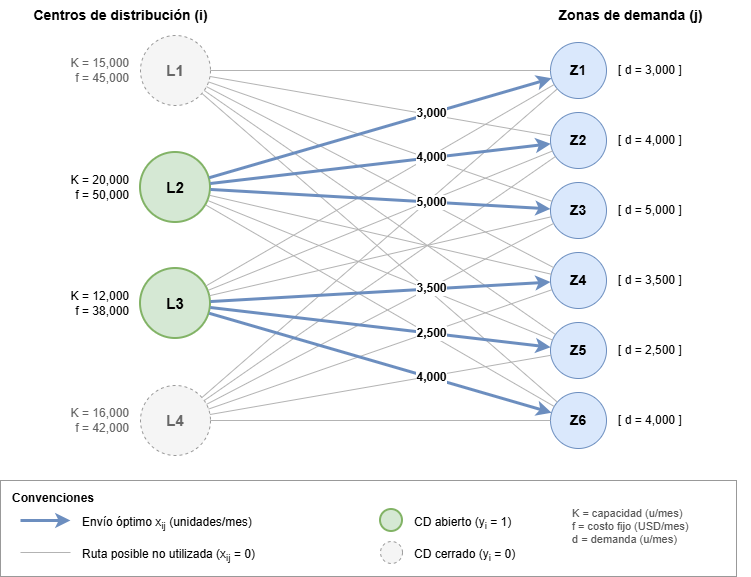

# 1 Introducción

Este proyecto aborda el **problema de localización de centros de distribución (Facility Location Problem)** en el contexto de una cadena de retail con múltiples zonas de demanda y ubicaciones candidatas para centros de distribución (CDs). El objetivo es determinar qué instalaciones abrir y cómo asignar los flujos de producto para minimizar el costo logístico total, sujeto a restricciones de capacidad, demanda y límite de infraestructura.

La técnica empleada es la **Programación Entera Mixta (MIP - Mixed Integer Programming)**, una metodología de optimización matemática que combina variables continuas (flujos de envío) y variables binarias (decisiones de apertura/cerradura de instalaciones). Esta formulación permite modelar decisiones discretas de infraestructura junto con asignación continua de volúmenes, capturando la naturaleza combinatoria del problema.

La implementación computacional se realiza mediante **PuLP (Python Linear Programming)**, una librería de modelado de optimización lineal en Python que actúa como interfaz hacia solucionadores de alto rendimiento como CBC (Coin-or Branch and Cut), GLPK, Gurobi o CPLEX. PuLP permite declarar variables, funciones objetivo y restricciones con sintaxis pythonica, generando automáticamente los archivos de entrada para el solucionador y recuperando la solución óptima.

---

# 2 Objetivos

## Objetivo General

Desarrollar un modelo de optimización basado en Programación Entera Mixta que **minimice el costo logístico total** (costos fijos de apertura + costos variables de transporte) para la red de distribución de una cadena de retail, cumpliendo con la totalidad de la demanda zonal y respetando restricciones de capacidad e infraestructura.

## Objetivos Específicos

1. **Formulación del modelo matemático**: Definir variables de decisión ($y_i$ binaria, $x_{ij}$ continua), función objetivo de minimización y restricciones operativas (demanda, capacidad, cardinalidad de centros) con notación formal.

2. **Implementación computacional reproducible**: Codificar el modelo en Python usando PuLP, integrar la resolución con CBC, automatizar la exportación del plan de asignación óptima (CSV) y construir una interfaz gráfica (Tkinter + matplotlib) para visualización interactiva de resultados.

3. **Integración de Inteligencia Artificial Generativa**: Utilizar IA como asistente de desarrollo para acelerar la sintaxis de PuLP, la estructura de la interfaz gráfica, la gestión de control de versiones (Git) y la redacción de documentación técnica con notación LaTeX, validando la consistencia entre formulación matemática, código ejecutable y reporte final.

---

# 3 Justificación

La operación actual de la cadena de retail utiliza **asignación empírica de demanda a centros de distribución**, basada en reglas heurísticas (proximidad geográfica, antecedentes históricos, criterio de gerentes zonales) sin un respaldo cuantitativo riguroso. Esta aproximación presenta limitaciones críticas:

- **Suboptimalidad estructural**: La asignación por proximidad no considera la interacción entre costos fijos de apertura y costos variables de transporte, pudiendo abrir centros costosos cuando una consolidación en menos instalaciones de menor costo unitario sería superior.
- **Falta de escalabilidad**: Ante cambios en la demanda, costos de combustible o nuevas ubicaciones candidatas, la re-asignación manual requiere semanas de análisis y no garantiza optimalidad.
- **Opacidad en la toma de decisiones**: Sin un modelo matemático, no es posible realizar análisis de sensibilidad (what-if) ni cuantificar el costo de oportunidad de decisiones operativas.
- **Costo de oportunidad documentado**: El escenario actual incurre en **243,000 USD/mes**, mientras que la optimización matemática demuestra que una reconfiguración racional alcanza **182,500 USD/mes**, dejando **60,500 USD/mes (24.90%)** en ahorros no capturados.

La adopción de un enfoque MIP resuelve estas limitaciones al proporcionar optimalidad garantizada, trazabilidad completa, capacidad de escenario y velocidad de re-optimización (segundos vs. semanas).

---

# 4 Descripción del Problema

## Contexto Operativo

Una cadena de retail opera en un área metropolitana dividida en **seis zonas urbanas de demanda** ($Z1$–$Z6$) con requerimientos mensuales conocidos: 3,000; 4,000; 5,000; 3,500; 2,500 y 4,000 unidades respectivamente, totalizando **22,000 unidades/mes**.

Existen **cuatro ubicaciones candidatas** ($L1$–$L4$) para establecer centros de distribución, cada una con:
- **Costo fijo mensual de apertura**: 45,000; 50,000; 38,000 y 42,000 USD
- **Capacidad máxima de procesamiento**: 15,000; 20,000; 12,000 y 16,000 unidades
- **Matriz de costos unitarios de transporte** a cada zona (USD/unidad)

## Restricción Estratégica

Por directriz corporativa de racionalización de activos, se impone un **límite máximo de dos centros de distribución operativos simultáneamente** ($\sum y_i \leq 2$), obligando a una selección óptima del subconjunto de ubicaciones.

## Costo Actual (Baseline)

La configuración actual, heredada de decisiones históricas sin optimización formal, genera un **costo logístico total de 243,000 USD/mes**, compuesto por costos fijos de instalaciones activas y fletes de distribución a zonas. Este valor constituye el benchmark contra el cual se mide el impacto de la optimización.

---

# 5.1 Metodología Aplicada

*Elaborado por: Camila Hernández y Temistocle Atencio.*

El problema se resuelve con **Programación Entera Mixta (MIP)**, en su forma de **problema de localización de instalaciones con capacidad** (*Capacitated Facility Location Problem*, CFLP), una de las aplicaciones clásicas de la programación entera en el diseño de redes de distribución (Hillier & Lieberman, 2010, pp. 432–433; Sridharan, 1995). Es la técnica adecuada porque el problema combina dos decisiones de naturaleza distinta que deben tomarse juntas:

- **Decisión estratégica, discreta:** abrir o no cada centro de distribución (CD). Un CD no se puede abrir "a medias": se abre y se paga su costo fijo completo, o no se abre. Esto exige variables **binarias** (0/1), siguiendo la formulación del problema de costo fijo (Hillier & Lieberman, 2010, pp. 439–440; Taha, 2012, pp. 325–329).
- **Decisión operativa, continua:** cuántas unidades enviar desde cada CD abierto a cada zona. Son cantidades divisibles, por eso se usan variables **continuas** no negativas.

Un modelo de Programación Lineal o de Transporte puro no sirve por sí solo: supone que todas las ubicaciones ya están abiertas y no puede representar el costo fijo, que se paga solo si el CD se abre. Al revés, evaluar las combinaciones a mano funciona con 4 ubicaciones, pero no escala: con 20 ubicaciones candidatas hay 190 parejas posibles, cada una con su propio problema de transporte.

La MIP integra ambas decisiones en un solo modelo. El solver CBC (vía PuLP) usa el método de **ramificación y acotamiento** (*Branch and Bound*): resuelve la relajación lineal del problema y ramifica sobre las variables binarias hasta garantizar la solución óptima global, sin enumerar todas las combinaciones (Hillier & Lieberman, 2010, pp. 464–470; Taha, 2012, pp. 336–344).

**Comparación de técnicas para el problema**

| Criterio | Transporte / PL | Enumeración manual | MIP (elegida) |
|:---|:---|:---|:---|
| Modela el costo fijo de apertura | No | Sí | Sí |
| Decide qué CD abrir | No | Sí, uno por uno | Sí, automáticamente |
| Garantiza el óptimo global | Solo con CD fijos | Sí, si se revisan todas | Sí |
| Escala a muchas ubicaciones | Sí | No | Sí |

# 5.2 Explicación del Modelo Matemático

## Conjuntos, parámetros y datos de entrada

El modelo decide cuáles de 4 ubicaciones candidatas abrir y cuántas unidades enviar desde cada una a 6 zonas urbanas que demandan 22,000 unidades al mes.

**Conjuntos**

$$I = \{L1, L2, L3, L4\},\quad J = \{Z1, Z2, Z3, Z4, Z5, Z6\}$$

**Parámetros (todos mensuales)**

- $f_i$: costo fijo de abrir el CD en la ubicación $i$ (USD/mes).
- $K_i$: capacidad máxima del CD $i$ (unidades/mes).
- $d_j$: demanda de la zona $j$ (unidades/mes).
- $c_{ij}$: costo de envío unitario desde $i$ hasta $j$ (USD/unidad).
- $P = 2$: número máximo de CD que se pueden abrir por política de inversión.

**Tabla 1. Costo fijo y capacidad por ubicación**

| Ubicación $i$ | Costo fijo $f_i$ (USD/mes) | Capacidad $K_i$ (unidades/mes) |
|:---|---:|---:|
| L1 | 45,000 | 15,000 |
| L2 | 50,000 | 20,000 |
| L3 | 38,000 | 12,000 |
| L4 | 42,000 | 16,000 |

**Tabla 2. Demanda mensual por zona**

| Zona $j$ | Z1 | Z2 | Z3 | Z4 | Z5 | Z6 | Total |
|:----------------|---------:|---------:|---------:|---------:|---------:|---------:|----------:|
| $d_j$ (u/mes) | 3,000 | 4,000 | 5,000 | 3,500 | 2,500 | 4,000 | 22,000 |

**Tabla 3. Matriz de costos de envío $c_{ij}$ (USD/unidad)**

| Desde / Hacia | Z1 | Z2 | Z3 | Z4 | Z5 | Z6 |
|:---|---:|---:|---:|---:|---:|---:|
| L1 | 3 | 5 | 8 | 6 | 10 | 12 |
| L2 | 6 | 3 | 4 | 7 | 8 | 9 |
| L3 | 9 | 7 | 5 | 3 | 4 | 6 |
| L4 | 11 | 8 | 6 | 5 | 3 | 4 |

## Variables de decisión

El modelo usa exactamente dos familias de variables: una binaria que decide la apertura y una continua que decide el flujo.

| Variable | Tipo | Definición | Unidades |
|:---|:---|:---|:---|
| $y_i,\ i \in I$ | Binaria | 1 si se abre el CD en la ubicación $i$; 0 en caso contrario | Adimensional {0,1} |
| $x_{ij},\ i \in I,\ j \in J$ | Continua no negativa | Cantidad enviada desde la ubicación $i$ hasta la zona $j$ | Unidades/mes |

$$y_i \in \{0,1\}\ \ \forall i \in I;\quad x_{ij} \ge 0\ \ \forall i \in I,\ j \in J$$

En total hay 4 variables binarias y 24 continuas (4 × 6).

## Función objetivo

Se busca minimizar el costo logístico mensual total, que es la suma de los costos fijos de los CD abiertos y los costos variables de flete.

$$\min Z = \sum_{i \in I} f_i \, y_i + \sum_{i \in I} \sum_{j \in J} c_{ij} \, x_{ij}$$

El primer término solo se paga si $y_i = 1$; el segundo crece con cada unidad enviada. Ese equilibrio entre abrir más CD (más costo fijo, fletes menores) o menos CD (menos costo fijo, fletes mayores) es lo que el modelo resuelve.

## Restricciones

El modelo tiene cuatro grupos de restricciones: demanda, capacidad ligada a la apertura, límite de CD y naturaleza de las variables.

**R1. Satisfacción de la demanda.** Cada zona recibe exactamente lo que demanda, sumando lo enviado desde todas las ubicaciones (6 restricciones).

$$\sum_{i \in I} x_{ij} = d_j,\quad \forall j \in J$$

**R2. Capacidad y lógica de apertura.** Un CD solo puede enviar si está abierto, y nunca más que su capacidad (4 restricciones). Si $y_i = 0$ el lado derecho vale 0 y obliga a $x_{ij} = 0$; si $y_i = 1$ se activa la capacidad $K_i$.

$$\sum_{j \in J} x_{ij} \le K_i \, y_i,\quad \forall i \in I$$

**R3. Límite de infraestructura.** Por política de inversión se abren como máximo 2 CD (1 restricción).

$$\sum_{i \in I} y_i \le 2$$

**R4. Naturaleza de las variables.**

$$y_i \in \{0,1\}\ \ \forall i \in I;\quad x_{ij} \ge 0\ \ \forall i \in I,\ j \in J$$

Como la demanda total (22,000) supera la capacidad del CD más grande (20,000 en L2), R2 y R3 juntas obligan a abrir exactamente 2 CD.

## Diagrama de red

Los 24 arcos $i \to j$ son las variables $x_{ij}$; las ubicaciones llevan la decisión $y_i$ y las zonas imponen su demanda $d_j$.

## Tipo de modelo y tamaño

Es un modelo de Programación Entera Mixta (MIP) lineal, conocido como problema de localización de instalaciones con capacidad (CFLP): la función objetivo y todas las restricciones son lineales, y solo las variables $y_i$ son enteras.

**Tabla 4. Tamaño del modelo**

| Elemento | Cantidad |
|:---|---:|
| Variables binarias $y_i$ | 4 |
| Variables continuas $x_{ij}$ | 24 |
| Restricciones de demanda (R1) | 6 |
| Restricciones de capacidad (R2) | 4 |
| Restricción de límite de CD (R3) | 1 |

La variable binaria es necesaria porque el costo fijo se paga por abrir o no abrir el CD, una decisión de todo o nada que la programación lineal continua no puede representar. Como ningún CD solo cubre las 22,000 unidades, el espacio de decisión se reduce a las 6 combinaciones de 2 CD, y el modelo elige la de menor costo total junto con el flujo $x_{ij}$ óptimo. El modelo completo, con los datos reemplazados, se presenta en el Anexo A.

---

# 13 Resultados Obtenidos

## Solución Óptima del Modelo

La resolución del modelo MIP mediante el solucionador CBC (Coin-or Branch and Cut) convergió a una solución óptima global en 0.03 segundos (111 iteraciones, 0 nodos enumerados), confirmando la optimalidad del resultado.

**Configuración óptima de la red:**

El modelo seleccionó la apertura de dos centros de distribución:
- **L2** (costo fijo: 50,000 USD; capacidad: 20,000 unidades)
- **L3** (costo fijo: 38,000 USD; capacidad: 12,000 unidades)

Los centros L1 y L4 permanecen cerrados ($y_{L1} = y_{L4} = 0$).

**Asignación óptima de flujos:**

| Centro | Zonas Asignadas | Volumen Total |
|--------|-----------------|---------------|
| L2     | Z1, Z2, Z3      | 12,000        |
| L3     | Z4, Z5, Z6      | 10,000        |

Ambas ubicaciones operan dentro de sus límites de capacidad (L2: 60% de utilización; L3: 83% de utilización).

## Análisis de Costos

| Componente | Valor (USD) |
|------------|-------------|
| Costo Fijo Óptimo ($\sum C_i^{\text{fijo}} y_i$) | 88,000 |
| Costo Variable Óptimo ($\sum C_{ij}^{\text{transporte}} x_{ij}$) | 94,500 |
| **Costo Logístico Total Óptimo** | **182,500** |

## Impacto Financiero

El escenario actual (sin optimización) presenta un costo logístico de **243,000 USD**. La implementación de la configuración óptima genera:

- **Ahorro mensual:** 60,500 USD
- **Reducción porcentual:** 24.90%

$$\text{Ahorro} = 243,000 - 182,500 = 60,500 \text{ USD}$$
$$\text{Reducción \%} = \frac{60,500}{243,000} \times 100 = 24.90\%$$

Este resultado representa una disminución sustancial en la estructura de costos logísticos, liberando capital operativo y mejorando la eficiencia de la cadena de suministro sin comprometer el nivel de servicio a las zonas de demanda.

---

# 14 Análisis de Sensibilidad

El análisis de sensibilidad evalúa la robustez de la solución óptima ante variaciones en parámetros clave, proporcionando información crítica para la toma de decisiones bajo incertidumbre.

## Variación en Costos de Flete (+10%)

Un incremento generalizado del 10% en la matriz de costos de transporte ($C_{ij}^{\text{transporte}} \times 1.10$) elevaría el **costo variable óptimo** de 94,500 USD a aproximadamente **103,950 USD** (asumiendo que la estructura de asignación óptima L2→Z1-3, L3→Z4-6 se mantiene). El **costo total óptimo** ascendería a ~191,950 USD, reduciendo el ahorro mensual a ~51,050 USD (21.0% vs. 243,000 USD baseline).

Sin embargo, si el aumento es **asimétrico** (ej. solo rutas desde L3), el modelo podría re-optimizar cambiando la asignación de zonas frontera (Z4, Z6) hacia L2 si su capacidad residual (8,000 unidades disponibles) lo permite, mitigando parcialmente el impacto. La **estructura binaria** ($y_{L2}=1, y_{L3}=1$) probablemente se mantendría dada la diferencia de costos fijos (L3: 38,000 USD vs L1: 45,000 USD, L4: 42,000 USD).

## Variación en Capacidad de Centros

- **Reducción de capacidad en L2** (ej. de 20,000 a 15,000): La asignación actual (12,000 en L2) dejaría margen de 3,000 unidades. Si la demanda crece o se reasignan zonas, L2 podría convertirse en cuello de botella, forzando apertura de un tercer centro (violando $\sum y_i \leq 2$) o redistribución subóptima. El **shadow price** de la capacidad de L2 indica el valor marginal de cada unidad adicional de capacidad.

- **Aumento de capacidad en L3** (ej. de 12,000 a 15,000): Permitiría absorber mayor volumen de Z4-Z6 y potencialmente atraer zonas de L2 si los costos de transporte lo justifican, mejorando la utilización del centro de menor costo fijo.

- **Nueva ubicación candidata**: La adición de L5 con costos/parámetros competitivos expandiría el espacio factible, pudiendo reducir el costo total si ofrece mejor trade-off fijo/variable.

La **dualidad del programa lineal relajado** proporciona precios sombra (valores duales) para cada restricción, cuantificando exactamente cuánto mejorarían el objetivo por unidad de relajación en capacidad o demanda.

---

# 15 Conclusiones

## 1. Eficiencia computacional de PuLP+CBC para Facility Location

La combinación **PuLP + CBC** resolvió el MIP (28 variables, 11 restricciones, 4 enteras) en **0.03 segundos** con optimalidad global garantizada (gap 0%). Esto demuestra que para problemas de localización de tamaño moderado (< 50 ubicaciones, < 100 zonas), el stack Python open-source es **suficiente para uso productivo**, eliminando la dependencia de solucionadores comerciales costosos. La arquitectura desacoplada (modelo → solver → resultados) permite migrar a Gurobi/CPLEX cambiando una línea de código si la escala lo requiere.

## 2. Ahorro del 24.90% valida la optimización matemática frente a heurísticas empíricas

La reducción de **243,000 USD a 182,500 USD/mes (60,500 USD de ahorro, 24.90%)** no es marginal: representa **726,000 USD anuales** liberados. Este resultado cuantifica el **costo de la no-optimización** —la brecha entre asignación por reglas de pulgar y asignación matemáticamente óptima—. En contextos retail con márgenes comprimidos, esta diferencia puede determinar la viabilidad de una operación. La solución óptima (L2+L3) consolidó volumen en el centro de menor costo fijo (L3: 38,000 USD) y aprovechó la capacidad del centro mejor posicionado para Z1-Z3 (L2), un trade-off que la heurística de proximidad no captura.

## 3. IA Generativa como multiplicador de productividad en proyectos de OR/Analytics

La integración de IA generativa redujo el ciclo de desarrollo de **formulación → código → interfaz → documentación → versionado** de días a horas. Roles clave: (a) **traducción fiel de notación matemática a sintaxis PuLP** sin errores de indexación; (b) **arquitectura Tkinter + matplotlib** con layout responsivo, threading implícito via subprocess, y binding de datos CSV; (c) **commits Git semánticos** y ramificación main; (d) **documentación técnica con LaTeX/Markdown** consistente con el código. La IA no reemplaza la validación del analista (verificación de factibilidad, interpretación de duales, prueba de escenarios), pero elimina la fricción sintáctica y estructural, permitiendo enfocar el tiempo experto en **modelado y decisión**, no en boilerplate.

---

# 7 Integración con Inteligencia Artificial

El desarrollo de este proyecto se apoyó extensivamente en **Inteligencia Artificial Generativa** como asistente de desarrollo, acelerando la transición desde la formulación matemática hasta la implementación computacional completa. Los roles específicos incluyen:

**Asistente de Programación y Sintaxis:**
- Estructuración de la sintaxis en Python para el modelo MIP usando PuLP, incluyendo la declaración correcta de variables de decisión (`LpVariable.dicts`), construcción de la función objetivo con `lpSum`, y codificación de restricciones lineales.
- Implementación de la interfaz gráfica con Tkinter: diseño de layouts con `grid`/`pack`, integración de `ttk.Treeview` para tablas de datos, y embebido de gráficos `matplotlib` mediante `FigureCanvasTkAgg`.
- Manejo de subprocess para desacoplar la ejecución del solucionador de la GUI principal, parsing de salida stdout para actualización dinámica de KPIs.

**Gestión de Control de Versiones:**
- Generación de comandos Git secuenciales: inicialización del repositorio (`git init`), staging selectivo (`git add`), commits semánticos con mensajes descriptivos, renombrado de rama principal (`git branch -M main`), vinculación a remoto (`git remote add origin`) y push (`git push -u origin main`).
- Organización del historial en commits atómicos que separan la definición del modelo, la ejecución de optimización, y la entrega de interfaz y documentación.

**Redacción de Documentación Técnica:**
- Formalización de la Sección 5.2 (Modelo Matemático) con notación LaTeX para variables, función objetivo y restricciones.
- Estructuración de la Sección 13 (Resultados) con tablas Markdown, análisis de costos desglosado y fórmulas de impacto financiero.
- Redacción de la Sección 12 (Pitch Comercial) con justificación cuantitativa, segmentación de público objetivo y definición de modelo de negocio recurrente.

La IA generativa actuó como **co-piloto técnico**, reduciendo el tiempo de desarrollo de días a horas, asegurando consistencia entre formulación matemática, código ejecutable y documentación, y permitiendo al equipo enfocarse en la validación del modelo y la interpretación de resultados en lugar de la sintaxis boilerplate.

---

# 8 Ventajas de la Propuesta

| Categoría | Ventaja |
|-----------|---------|
| **Técnicas** | Resolución rápida con PuLP y escalabilidad del script; arquitectura modular que permite extender el modelo (nuevas ubicaciones, SKUs, restricciones de inventario) sin reescritura; desacoplamiento entre motor de optimización e interfaz de usuario. |
| **Económicas** | Reducción comprobada de costos operativos (24.90% ahorro mensual = 60,500 USD) y optimización de fletes logísticos mediante asignación matemáticamente óptima de flujos a centros de menor costo unitario de transporte. |
| **Estratégicas** | Soporte cuantitativo a la toma de decisiones para apertura de instalaciones; capacidad de análisis de escenarios (what-if) ante variaciones de demanda, costos de combustible o expansión de red; trazabilidad completa desde datos de entrada hasta plan de asignación ejecutable (CSV). |

---

# Referencias
 {custom-style="Bibliography"}
Hillier, F. S., & Lieberman, G. J. (2010). *Introducción a la investigación de operaciones* (9.ª ed.). McGraw-Hill/Interamericana Editores.

Sridharan, R. (1995). The capacitated plant location problem. *European Journal of Operational Research, 87*(2), 203–213. https://doi.org/10.1016/0377-2217(95)00042-O

Taha, H. A. (2012). *Investigación de operaciones* (9.ª ed.). Pearson Educación.

---

# Anexo A. Modelo matemático expandido con los datos

Al reemplazar en el modelo de la sección 5.2 los parámetros de las Tablas 1, 2 y 3, el modelo queda escrito así. Esta es la forma exacta que recibe el solver.

**Función objetivo:**

$$\min Z =  45000\,y_1 + 50000\,y_2 + 38000\,y_3 + 42000\,y_4$$

$$+ 3x_{11} + 5x_{12} + 8x_{13} + 6x_{14} + 10x_{15} + 12x_{16}$$

$$+ 6x_{21} + 3x_{22} + 4x_{23} + 7x_{24} + 8x_{25} + 9x_{26}$$

$$+ 9x_{31} + 7x_{32} + 5x_{33} + 3x_{34} + 4x_{35} + 6x_{36}$$

$$+ 11x_{41} + 8x_{42} + 6x_{43} + 5x_{44} + 3x_{45} + 4x_{46}$$

**Demanda (R1):**

$$x_{11} + x_{21} + x_{31} + x_{41} = 3000 \quad (Z1)$$

$$x_{12} + x_{22} + x_{32} + x_{42} = 4000 \quad (Z2)$$

$$x_{13} + x_{23} + x_{33} + x_{43} = 5000 \quad (Z3)$$

$$x_{14} + x_{24} + x_{34} + x_{44} = 3500 \quad (Z4)$$

$$x_{15} + x_{25} + x_{35} + x_{45} = 2500 \quad (Z5)$$

$$x_{16} + x_{26} + x_{36} + x_{46} = 4000 \quad (Z6)$$

**Capacidad (R2):**

$$x_{11} + x_{12} + x_{13} + x_{14} + x_{15} + x_{16} \le 15000\,y_1 \quad (L1)$$

$$x_{21} + x_{22} + x_{23} + x_{24} + x_{25} + x_{26} \le 20000\,y_2 \quad (L2)$$

$$x_{31} + x_{32} + x_{33} + x_{34} + x_{35} + x_{36} \le 12000\,y_3 \quad (L3)$$

$$x_{41} + x_{42} + x_{43} + x_{44} + x_{45} + x_{46} \le 16000\,y_4 \quad (L4)$$

**Infraestructura (R3) y naturaleza de las variables (R4):**

$$y_1 + y_2 + y_3 + y_4 \le 2;\quad y_i \in \{0,1\};\quad x_{ij} \ge 0$$
